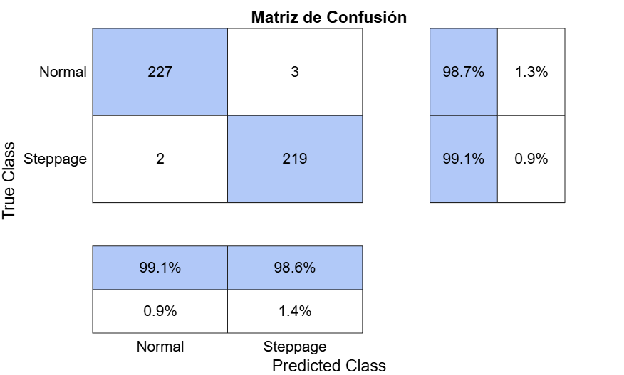
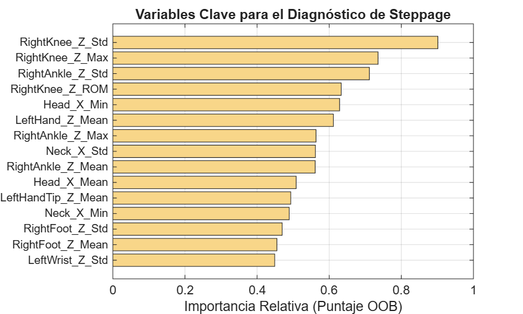

# Steppage Gait Classification from 3D Skeleton Time-Series

Random Forest classifier that distinguishes **normal vs. steppage gait** from Kinect v2 skeleton tracking (25 joints × 3 axes), plus a biomechanical analysis of *which* kinematic features drive the decision. Implemented in MATLAB.

Course project — *Biomechanics*, Universidad de Monterrey (UDEM).

## Results (held-out test set, n = 451 recordings)

| Metric | Value |
|---|---|
| Accuracy | **98.89 %** |
| F1-score | **98.87 %** |
| Recall (steppage) | 99.10 % |
| Precision (steppage) | 98.65 % |
| 5-fold CV accuracy (train set) | 98.62 % |
| Train (resubstitution) accuracy | 100 % |

Top predictors by OOB permutation importance: **right knee / ankle vertical-axis variability, maximum and ROM** (exaggerated hip-knee flexion to clear the foot) and **head/neck displacement** (compensatory trunk strategy).

<p align="center">
  
  
</p>

## Pipeline

```
CSV (time, 25 joints xyz) ─► drop duplicated timestamps ─► resample to uniform 30 Hz (spline)
   ─► 2nd-order Butterworth low-pass 6 Hz, zero-phase (filtfilt)
   ─► 5 features per signal (max, min, ROM, mean, SD) → 375 features / recording
   ─► stratified 80/20 hold-out ─► bagged trees (100) ─► test metrics + OOB importance
```

| Stage | Choice | Rationale |
|---|---|---|
| Resampling | Spline to 30 Hz | Kinect timestamps are irregular and occasionally duplicated |
| Filtering | Butterworth LP 6 Hz, `filtfilt` | Standard cut-off for gait kinematics; zero-phase preserves event timing |
| Features | Max, min, ROM, mean, SD per axis | Interpretable, length-independent summary of each trajectory |
| Model | `fitcensemble` (Bag, 100 trees, reproducible) | Robust to many correlated features; gives OOB importance |
| Validation | Stratified hold-out + 5-fold CV + train/CV gap | Over-fitting check (gap 1.4 %) |

## Dataset

[Pathological Gait Datasets](https://github.com/kooksung/pathological_gait_datasets): 10 subjects, each simulating normal and steppage gait, 20 trials per class, 6 Kinect views → 2,400 recordings (2,259 after removing corrupted files). See [`data/README.md`](data/README.md).

## Repository structure

```
live_scripts/   original MATLAB Live Scripts (.mlx) with outputs
  PathGaitAnalysis.mlx           EDA, skeleton animation, pelvic tilt
  PathGaitFeatureExtraction.mlx  resampling, filtering, 375-feature table
  PathGaitRandomForest.mlx       training, evaluation, OOB importance, figures
  PathGaitSaveFigures.mlx        knee/ankle and head trajectories (normal vs. steppage)
src/            plain-text .m exports of the live scripts (readable on GitHub)
results/        confusion matrix, feature importance, boxplots, trajectories
```

## How to run

MATLAB R2023b+ with Signal Processing and Statistics & Machine Learning Toolboxes.
1. Download the dataset (see `data/README.md`) and set the paths in `PathGaitFeatureExtraction`.
2. Run `PathGaitFeatureExtraction` → `Dataset_Marcha_Procesado.mat`.
3. Run `PathGaitRandomForest` (first section renames the 375 features, then trains and evaluates).

## Limitations

- **Split is per recording, not per subject or trial.** The six Kinect views of the same walk, and trials from the same 10 subjects, can fall in both train and test, so the reported metrics are optimistic. A **leave-one-subject-out** evaluation is the correct next step.
- Steppage is **simulated by healthy subjects**, so generalization to clinical foot-drop is untested.
- Features are global per recording; gait-cycle segmentation would allow phase-specific features.

## Author

Diego Adrián Castro Ovalle — Biomedical Engineering, UDEM.
